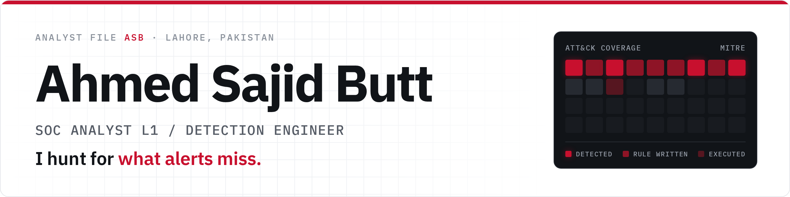

<picture>
  <source media="(prefers-color-scheme: dark)" srcset="assets/banner-dark.png">
  
</picture>

I investigate incidents, hunt for what alerts miss, and build detection content from the ground up across Microsoft Defender XDR, Wazuh and the ELK Stack. Computer Science graduate (2025) with a completed SOC internship, open to SOC roles, remote or in Pakistan.

**[Portfolio](https://cyberahmedx.github.io)** · **[LinkedIn](https://linkedin.com/in/a-sajid)** · **[Email](mailto:ahmedsajid_bw@proton.me)** · **[Resume](https://cyberahmedx.github.io/assets/Ahmed_Sajid_Butt_Resume.pdf)**

## Featured work

**[Vigil](https://github.com/CyberAhmedX/Vigil)** - SOC detection lab and incident response 
Wazuh, TheHive and OpenSearch behind an Nginx reverse proxy. A four-stage web app compromise (SQL injection, XSS, IDOR, simulated ransomware), each stage detected in Wazuh, escalated to TheHive automatically and closed with a written verdict. Mapped to MITRE ATT&CK.

**[Sentinel-Forge](https://github.com/CyberAhmedX/Sentinel-Forge)** - Cloud SOC home lab 
ELK Stack on Vultr with Sysmon endpoint telemetry, custom Kibana detection rules, adversary simulation with Mythic C2, and automatic ticket creation on alert.

**[Network Security Scanner](https://github.com/CyberAhmedX/Network-Security-Scanner-with-Firewall-Rule-Simulator)** - Scanner with real firewall enforcement 
Flask and Nmap with live WebSocket updates. With admin or root rights, rules run real iptables or netsh commands. Flags ports that opened since the last scan and writes SIEM-ready events in Elastic Common Schema, with custom Wazuh rules tested on Wazuh 4.14.9. Fixed a command injection found in self-review.

**[CipherVault](https://github.com/CyberAhmedX/CipherVault)** - Browser encryption tool · [live demo](https://cyberahmedx.github.io/CipherVault/) 
RSA-3072 + AES-256-GCM hybrid encryption and a passphrase-encrypted vault (PBKDF2, 600,000 iterations) on the Web Crypto API. Tested in Chromium, Firefox and WebKit, including a regression test for a stored XSS found and fixed in self-review.

## Experience

**Threat Detection & SOC Research Intern** - CNS Engineering, Lahore (Jan to Jun 2026)

- Investigated a high severity incident correlating 14 alerts and 13 pieces of forensic evidence, tracing the attack chain to root cause
- Ran 7 MITRE ATT&CK techniques with Atomic Red Team: 3 blocked outright by EDR, 3 detected through behavioral analysis alone
- Hunted with KQL in Advanced Hunting, surfacing 5 findings mapped to 6 ATT&CK techniques
- Onboarded 4 endpoints to Microsoft Defender for Endpoint through GPO and Intune, and wrote a phishing response playbook aligned to NIST SP 800-61

## Research

**[Leveraging AI for Real-Time Intrusion Detection in IoT-Enabled Healthcare Systems](https://ieeexplore.ieee.org/document/11523932)** (IEEE Xplore, co-author) 
A federated learning intrusion detection system using CNN, BiLSTM and GRU models, 99.8% accuracy. Presented at DataSciMI 2026, Bahria University.

## Skills

- **SIEM & XDR:** Microsoft Defender XDR, Microsoft Sentinel, Wazuh, ELK Stack, TheHive
- **Endpoint & identity:** Defender for Endpoint, Microsoft Intune, Active Directory, GPO
- **Query & analysis:** KQL, log analysis, threat hunting, incident triage
- **Tools & infrastructure:** Docker, OpenSearch, Sysmon, Mythic C2, Linux, Windows Server

## Certifications

- KC7 Security Analyst [I](https://kc7cyber.com/badges/earned/52218) and [II](https://kc7cyber.com/badges/earned/53957) (2026)
- TryHackMe [Cyber Security 101](https://tryhackme-certificates.s3-eu-west-1.amazonaws.com/THM-ZATJFPRVUB.pdf) and [Pre Security](https://tryhackme-certificates.s3-eu-west-1.amazonaws.com/THM-BWVW6461OE.pdf) (2025)
- [ISO 27001 Associate](https://www.skillfront.com/Badges/37132229470615), SkillFront (2024)
- [Google Cybersecurity Professional Certificate](https://www.credly.com/badges/26d8a0ab-a3b7-4365-bc92-66244c444d70/public_url), Coursera (2023)

Always happy to talk detection engineering, threat hunting or SOC ops.
