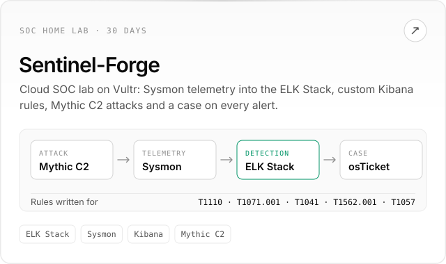

<picture><source media="(prefers-color-scheme: dark)" srcset="assets/banner-dark.svg"></picture>

I investigate incidents, hunt for what alerts miss, and build detection content from the ground up across Microsoft Defender XDR, Wazuh and the ELK Stack. Computer Science graduate (2025) with a completed SOC internship, open to SOC roles, remote or in Pakistan.

<a href="https://cyberahmedx.github.io"><picture><source media="(prefers-color-scheme: dark)" srcset="assets/btn-portfolio-dark.svg"></picture></a>
<a href="https://linkedin.com/in/a-sajid"><picture><source media="(prefers-color-scheme: dark)" srcset="assets/btn-linkedin-dark.svg"></picture></a>
<a href="mailto:ahmedsajid_bw@proton.me"><picture><source media="(prefers-color-scheme: dark)" srcset="assets/btn-email-dark.svg"></picture></a>
<a href="https://cyberahmedx.github.io/assets/Ahmed_Sajid_Butt_Resume.pdf"><picture><source media="(prefers-color-scheme: dark)" srcset="assets/btn-resume-dark.svg"></picture></a>

## Featured work

<a href="https://github.com/CyberAhmedX/Vigil"><picture><source media="(prefers-color-scheme: dark)" srcset="assets/card-vigil-dark.svg"></picture></a>
<a href="https://github.com/CyberAhmedX/Sentinel-Forge"><picture><source media="(prefers-color-scheme: dark)" srcset="assets/card-sentinel-forge-dark.svg"></picture></a>
<a href="https://github.com/CyberAhmedX/Network-Security-Scanner-with-Firewall-Rule-Simulator"><picture><source media="(prefers-color-scheme: dark)" srcset="assets/card-netscan-dark.svg"></picture></a>
<a href="https://github.com/CyberAhmedX/CipherVault"><picture><source media="(prefers-color-scheme: dark)" srcset="assets/card-ciphervault-dark.svg"></picture></a>

Each card opens its repo. CipherVault also runs in your browser: <a href="https://cyberahmedx.github.io/CipherVault/">try the live demo</a>.

## ATT&CK coverage

Techniques I have worked hands-on across my labs and SOC internship. The interactive version, with the story behind each one, is on <a href="https://cyberahmedx.github.io/#attack">my portfolio</a>.

## Experience

**Threat Detection & SOC Research Intern** - CNS Engineering, Lahore (Jan to Jun 2026)

- Investigated a high severity incident correlating 14 alerts and 13 pieces of forensic evidence, tracing the attack chain to root cause
- Ran 7 MITRE ATT&CK techniques with Atomic Red Team: 3 blocked outright by EDR, 3 detected through behavioral analysis alone
- Hunted with KQL in Advanced Hunting, surfacing 5 findings mapped to 6 ATT&CK techniques
- Onboarded 4 endpoints to Microsoft Defender for Endpoint through GPO and Intune, and wrote a phishing response playbook aligned to NIST SP 800-61

## Research

**[Leveraging AI for Real-Time Intrusion Detection in IoT-Enabled Healthcare Systems](https://ieeexplore.ieee.org/document/11523932)** (IEEE Xplore, co-author) 
A federated learning intrusion detection system using CNN, BiLSTM and GRU models, 99.8% accuracy. Presented at DataSciMI 2026, Bahria University.

## Skills

- **SIEM & XDR:** Microsoft Defender XDR, Microsoft Sentinel, Wazuh, ELK Stack, TheHive
- **Endpoint & identity:** Defender for Endpoint, Microsoft Intune, Active Directory, GPO
- **Query & analysis:** KQL, log analysis, threat hunting, incident triage
- **Tools & infrastructure:** Docker, OpenSearch, Sysmon, Mythic C2, Linux, Windows Server

## Certifications

- KC7 Security Analyst [I](https://kc7cyber.com/badges/earned/52218) and [II](https://kc7cyber.com/badges/earned/53957) (2026)
- TryHackMe [Cyber Security 101](https://tryhackme-certificates.s3-eu-west-1.amazonaws.com/THM-ZATJFPRVUB.pdf) and [Pre Security](https://tryhackme-certificates.s3-eu-west-1.amazonaws.com/THM-BWVW6461OE.pdf) (2025)
- [ISO 27001 Associate](https://www.skillfront.com/Badges/37132229470615), SkillFront (2024)
- [Google Cybersecurity Professional Certificate](https://www.credly.com/badges/26d8a0ab-a3b7-4365-bc92-66244c444d70/public_url), Coursera (2023)

Always happy to talk detection engineering, threat hunting or SOC ops.
